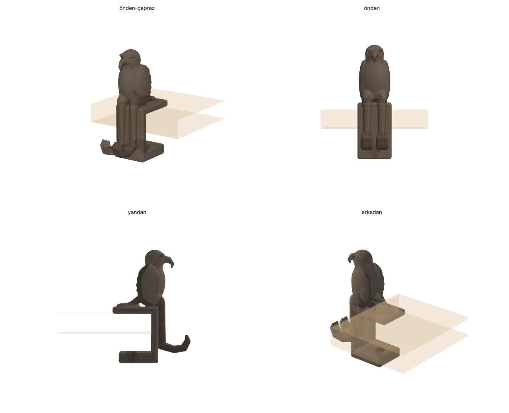

# Kartal askı · masaya delik açmadan

Masanın ön kenarına konmuş kartal. Alttan cıvatayla sıkılan kelepçeyle (C-işkence) takılır, masaya hiç vida girmez. Bacakları kelepçenin önünden iner, pençeleri öne uzanıp yukarı kıvrılarak kulaklık ve çanta askısı olur.

## Dosyalar

| Dosya | Açıklama |
|---|---|
| `kartal-aski-govde-baski-yonu.stl` | Kartal + kelepçe, baskıya hazır (yan yatık) |
| `kartal-aski-govde.stl` | Aynı parça, masadaki duruşunda |
| `kartal-aski-topuz.stl` | Tırtıllı sıkma topuzu, cıvata başı içine oturur |
| `kartal-aski-pabuc.stl` | Masanın altına basan pabuç (masayı çizmez) |
| `kartal_aski.py` | Üreten betik (ağız açıklığı, genişlik, cıvata ölçüsü buradan değişir) |

Ölçü: 44 × 101 × 148 mm. Kartal masanın üstünde ~80 mm yükselir. Pençeler kelepçenin önünde ~45 mm aşağıda.

## Donanım

- 1 × **M8×50 altıgen başlı cıvata**
- 1 × **M8 somun**
- İsteğe bağlı: üst plakanın altına ve pabucun üstüne keçe veya ince lastik

## Montaj

1. Somunu alt çenenin üst yüzündeki altıgen yuvaya bastırın.
2. Cıvata başını topuzun altındaki altıgen yuvaya sokun (gerekirse bir damla yapıştırıcı). Cıvatayı alttan çeneye geçirip somuna vidalayın.
3. Pabucu, alttaki çukuru cıvata ucuna gelecek şekilde takın.
4. Kelepçeyi masa kenarına geçirin, topuzu elle sıkın.

Uygun masa kalınlığı: **16–43 mm**. Daha ince masa için M8×60 cıvata kullanın.

## Baskı

- `-baski-yonu` dosyasını kullanın. Kelepçenin düz yanı tablaya oturur, katmanlar C şeklini boydan boya sarar. Bu en sağlam yön.
- **Ağaç (tree) destek** açın, yalnızca pençelerin ve gaganın altına gerekir.
- 0,2 mm katman, **4 duvar**, %25 doluluk. **PETG** önerilir (PLA da olur, sıkarken esneklik iyidir).
- Topuz ve pabuç desteksiz, düz basılır.
