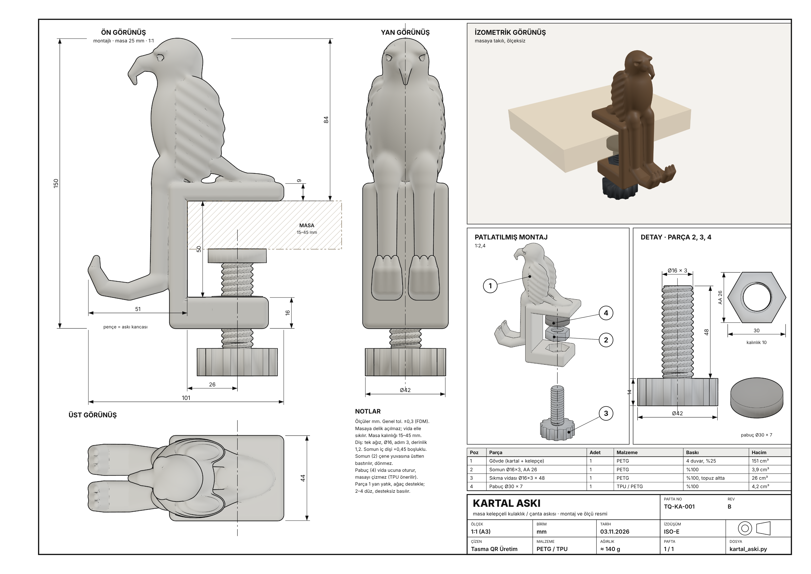

# Kartal askı · masaya delik açmadan

Masanın ön kenarına konmuş kartal. Kelepçeyle (C-işkence) takılır, masaya hiç vida girmez. Bacakları kelepçenin önünden iner, pençeleri öne uzanıp yukarı kıvrılarak kulaklık ve çanta askısı olur. **Hazır donanım gerekmez:** sıkma vidası, somunu ve pabucu da basılır.

## Dosyalar

| Poz | Dosya | Açıklama |
|---|---|---|
| 1 | `kartal-aski-govde-baski-yonu.stl` | Kartal + kelepçe, baskıya hazır (yan yatık). `kartal-aski-govde.stl` aynı parça, masadaki duruşunda |
| 2 | `kartal-aski-somun.stl` | Altıgen somun, AA 26 × 10, iç diş Ø16 adım 3 |
| 3 | `kartal-aski-vida.stl` | Tırtıllı topuzlu sıkma vidası, Ø16 adım 3, diş boyu 48 |
| 4 | `kartal-aski-pabuc.stl` | Masanın altına basan pabuç Ø30 × 7 |
| | `kartal-aski-teknik-resim.pdf` | A3 teknik resim: ölçülü görünüşler, patlatılmış montaj, parça listesi |
| | `kartal_aski.py` | Modelleri üreten betik |
| | `teknik-resim.html` | Paftanın kaynağı (three.js + STL'ler, yerel sunucudan açılır) |

Ölçü: 44 × 101 × 150 mm. Kartal masanın üstünde 84 mm yükselir. Pençeler masa kenarından 51 mm öne çıkar.

## Montaj

1. Somunu (2) alt çenenin üst yüzündeki altıgen yuvaya bastırın.
2. Vidayı (3) alttan çeneye geçirip somuna çevirin.
3. Pabucu (4) vidanın ucuna oturtun.
4. Kelepçeyi masa kenarına geçirin, topuzu elle sıkın.

Uygun masa kalınlığı: **15–45 mm**.

## Baskı

- Gövde (1): `-baski-yonu` dosyası, düz yan yüz tablada. **Ağaç destek** (yalnızca pençe ve gaga altı), 0,2 mm katman, 4 duvar, %25 doluluk, **PETG**.
- Vida (3): topuz tablada, dik. Somun (2): düz. Her ikisi **%100 doluluk**, destek yok, 0,16–0,2 mm katman.
- Pabuç (4): TPU önerilir (masayı çizmez, kaymaz). Yoksa PETG.
- Diş boşluğu 0,45 mm (radyal). Vida sıkı gelirse somunu %101 ölçekle basın.
