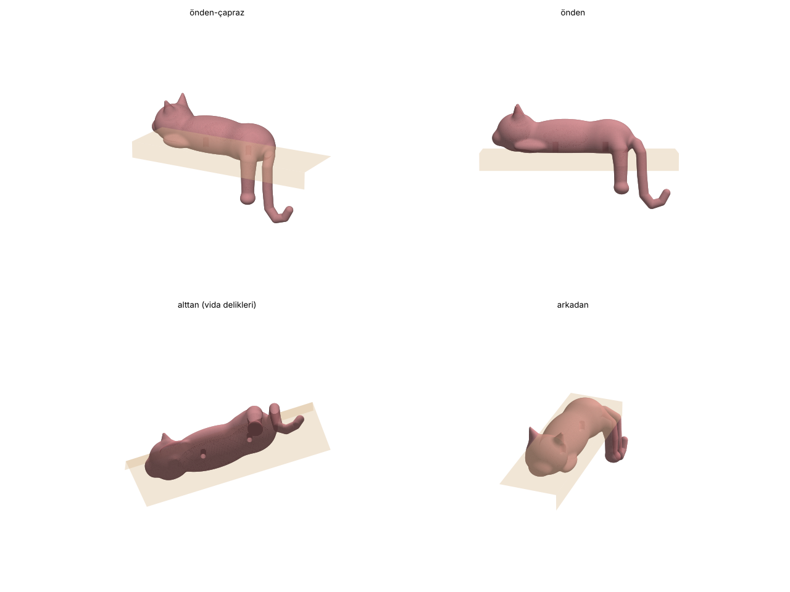

# Raf kedisi · 3D baskı

Rafın kenarına yatmış, bir arka bacağı ve kuyruğu aşağı sarkan kedi biblosu. Rafın altından vidalanır, vida üstten ve önden görünmez.

## Dosyalar

| Dosya | Açıklama |
|---|---|
| `raf-kedisi-insert-M4.stl` | Karın altında 2 adet Ø5,7 × 10 mm yuva, **M4 sıcak gömme somun (heat-set insert)** için |
| `raf-kedisi-ahsap-vida.stl` | Karın altında 2 adet Ø3,0 × 20 mm kılavuz delik, **Ø3,5–4 sunta/ahşap vidası** doğrudan girer |
| `*-baski-yonu.stl` | Aynı modeller, baskıya hazır yönde döndürülmüş |
| `raf_kedisi.py` | Modeli üreten betik (ölçü, vida yeri ve çapı buradan değişir) |

Ölçü: 184 × 60 × 105 mm (gövde rafın üstünde ~35 mm yüksek, bacak ve kuyruk ~57 mm aşağı sarkar).

## Montaj

- Vida delikleri arası **52 mm**: kenardan 20–22 mm içeride, rafın kenarına paralel.
- Kediyi rafa oturtun, kalçası (sarkan bacak tarafı) rafın ön kenarına dayansın. Delik yerlerini işaretleyip rafı delin.
- Alttan pullu vidayla sıkın. Raf kalınlığı + 8 mm (insert) veya + 15 mm (ahşap vida) boyunda vida seçin.

## Baskı

- `-baski-yonu` dosyasını kullanın: kedinin duvar tarafındaki düz, gizli yüzü tablaya oturur; destek yalnızca bacağın ve kuyruğun rafa bakan, görünmeyen yüzlerine değer.
- **Ağaç (tree) destek** açık, 0,2 mm katman, 3 duvar, %15 doluluk. PLA veya PETG olur.
